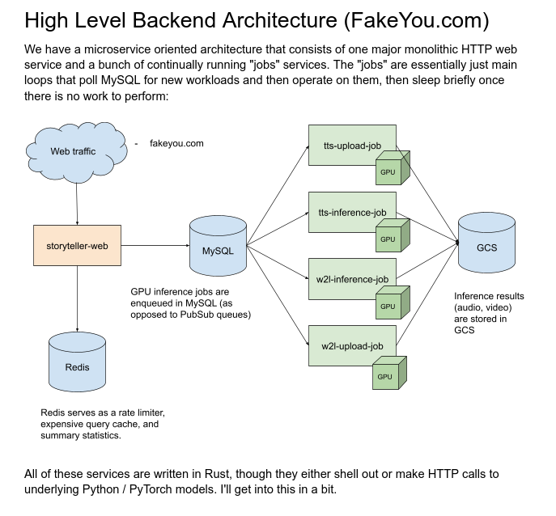
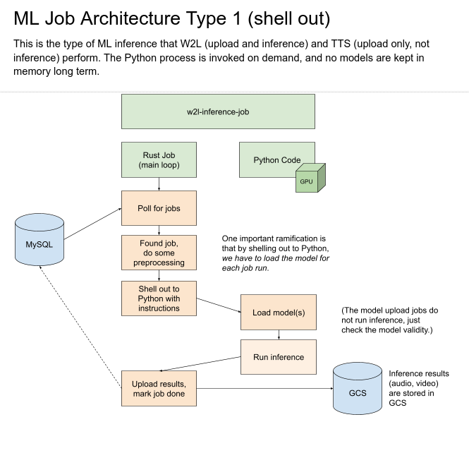
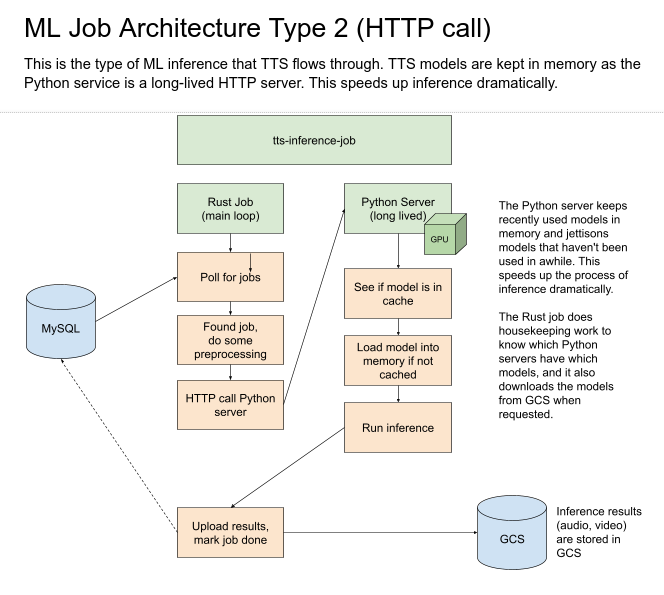

storyteller-ml
==============
The ML models that power FakeYou and other Storyteller functions.

This repository is in a bit of a rough shape, but should be improving.

TTS models (Tacotron, HifiGan, WaveGlow, etc.) live under [`tts/`, and you can find documentation there](tts/). 

We expect to add video, posture estimation, phoneme prediction, and other models soon.

Run Dockerized in Development
-----------------------------

### TTS

```bash

docker build .
docker run --rm --gpus all -it -p 8000:8000 --mount type=bind,source=/tmp,target=/tmp --entrypoint ./start_tts_server.sh [image name]
```

How This Works
--------------
We have a Rust monolith that controls the user interface, account system, and all the database CRUD operations.
It doesn't do any ML work itself or have any attached GPUs.

There are a series of worker pods ("jobs") that pull from work queues and run inference, then upload the results.



The jobs are written in Rust and either shell out to Python code or call an in-container Python server that attempts 
to LRU cache models in memory.





TODO
----

Core cleanup

- [ ] Cleanup Tacotron code 
  - [ ] Integrate WaveGlow and HifiGan more cleanly
  - [ ] Define the HTTP server interface
  - [ ] Define the model checking interface
  - [ ] Clean up in-memory LRU caching
  - [ ] There are two copies of Nemo. Why? Clean this up.
- [ ] Deployability
  - [ ] Clean up requirements.txt and upgrade packages 
  - [ ] Clean up Dockerfile

Docker image cleanup

- [ ] Remove docker-base-images-nvidia-cuda-experimental
- [ ] Remove inessential build pieces

Make the models sound better

- [ ] Arpabet
  - [ ] G2P
  - [ ] Arpabet custom dictionary
  - [ ] User-supplied Arpabet strings in braces

- [ ] Word break down 888 -> eight hundred eighty eight

- [ ] Support I18N
  - [ ] Accent character support

Introduce new models

- [ ] TalkNet
- [ ] GlowTTS + MelGan (vocoder)
- [ ] Make these work under the same venv

Lots more I haven't covered yet...
